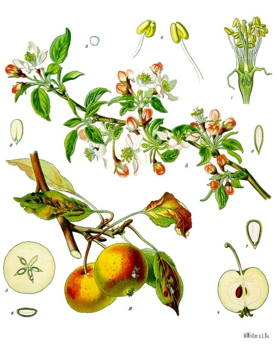

= Apple
:tags: fruit, pome

An apple is an edible xref:fruit.adoc[fruit] produced by an apple
tree (_Malus domestica_).  Botanically it is a xref:pome.adoc[pome].

Unlike the xref:orange.adoc[orange], which is a citrus, the apple has a firm
core of seeds at its centre.

.Some Apple Picture

